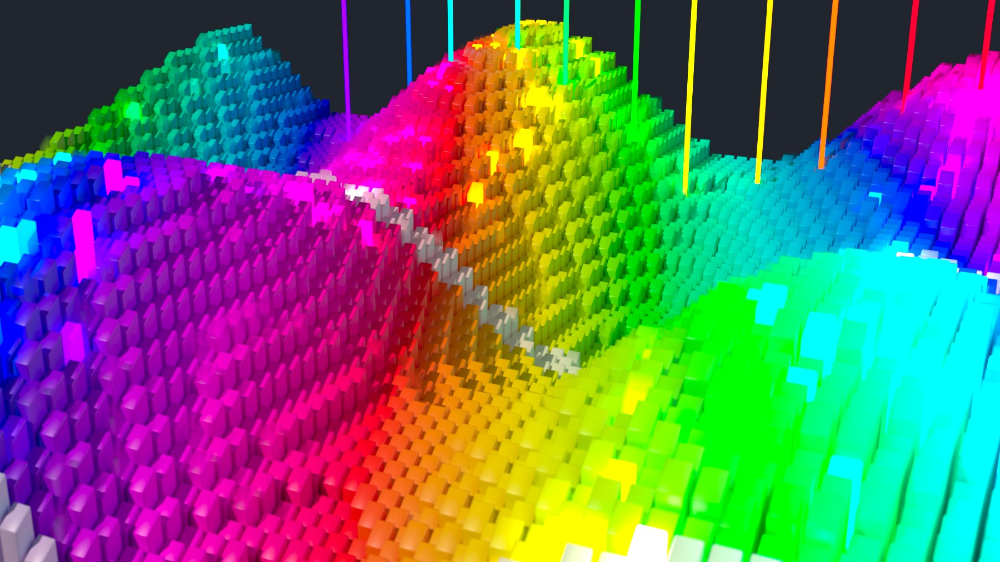
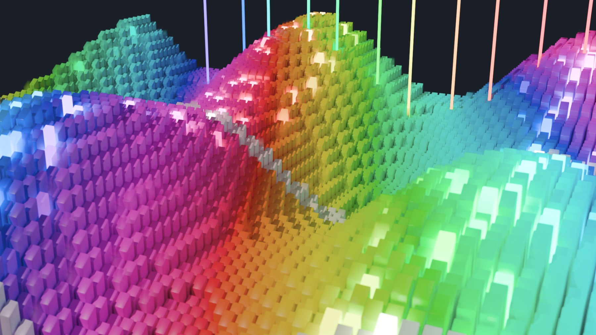

# minColor documentation

minColor is a set of After Effects effects and a panel for working in linear
light. minColor Input converts each file to one working space, you composite and
grade there, and minColor Output encodes the picture at the end. A highlight
knee and AgX are there when you want them.

*The proof footage (a Blender render, linear ACEScg, highlights to 55× diffuse
white, spectral lasers outside ACEScg), left un-tone-mapped, right through
minColor AgX at its defaults.*

## Start here

1. [Install](install.md): the effects, the panel and the presets, macOS and Windows.
2. [Quick start](quick-start.md): from an empty project to a render, in six steps.

## Guides

- [Color setups](color-setups.md): the three ways to run a project, which display
  to pick in the viewer, and where the delivery's encoding is chosen.
- [The minColor panel](panel.md): Set OCIO, In Rules, Apply In, Add Output.
- [Animation presets](presets.md): one-click Input, Output and AgX settings.
- [Troubleshooting](troubleshooting.md): missing configs, missing effects, black or
  clipped pictures.

## Effects (Effect > minColor)

| Effect | What it does |
| --- | --- |
| [minColor Input](effects/input.md) | Says what a file is (gamut, transfer, range) and brings it into the comp's linear working space. |
| [minColor Output](effects/output.md) | Encodes for a display or a delivery: a gamut matrix and a curve, no tonescale. |
| [minColor Grade](effects/grade.md) | Colour correction with Primaries wheels, HDR zone wheels and an HSL secondary. |
| [minColor Knee](effects/knee.md) | Rolls off highlights brighter than where they are going (HDR into SDR). |
| [minColor AgX](effects/agx.md) | AgX picture formation, parametric and HDR-capable; Blender-compatible at its defaults. |
| [minColor macOS Native Fix](effects/macos-fix.md) | Corrects After Effects' viewer on a Mac whose monitor is left in its native mode, when you are not using OCIO. |
| [minColor Grade (Legacy)](effects/grade-legacy.md) | The first Grade, under *minColor Legacy*: for projects made before 0.1.6. |
