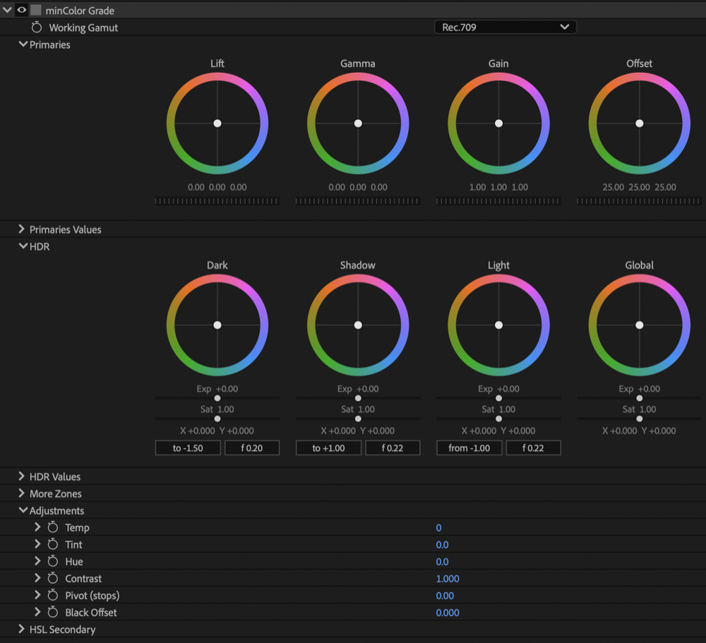
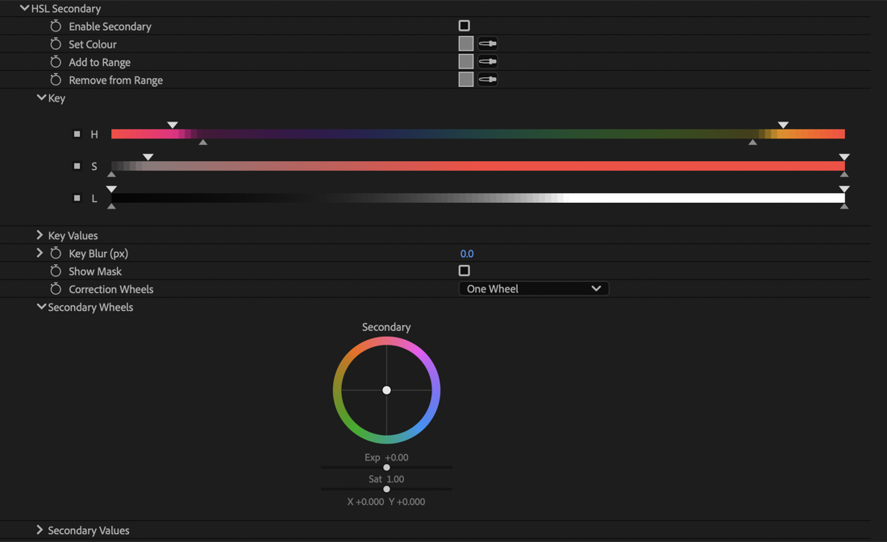

# minColor Grade

A colour corrector for linear light with the controls a colourist already knows
from a dedicated grading application: four Primaries wheels, HDR zone wheels, and
an HSL secondary. Put it between Input and Output: on a layer, or on an
adjustment layer below the Output.

New in 0.1.6. It replaces the first Grade, which stays installed as
[minColor Grade (Legacy)](grade-legacy.md) so projects made with it open and
render as before.

Set **Working Gamut** to what the comp is in. Inside, the Grade works in one
wide-gamut log grading space whatever that is, so a control does the same thing
in any comp.

## Handling the wheels

Every wheel, bar and box is a *relative* drag: a click never jumps a value, a
drag moves it from where it is. **Shift** drags a quarter as fast.
**Double-click** resets the one control under the mouse. Each drag and each reset
is one undo step.

The puck moves far less than the mouse, on purpose: a long drag is a small,
controllable push, and the puck stays near the centre for any sane grade. Read
the numbers under the wheel; the puck's position tells you little.

Each wheel row is drawn over ordinary sliders, kept in the twirl under it
(**Primaries Values**, **HDR Values**, **More Zones**, **Secondary Values**).
Use those to type a value, keyframe, write an expression or save a preset.

## Primaries

**Lift**, **Gamma**, **Gain** and **Offset**, each with a red, green and blue
value shown under its wheel, at rest 0, 0, 1 and 25.

- The **ball** pushes the wheel's three values toward a colour while holding
  their overall level: right raises blue, up raises red, green gives way.
- The **strip under the wheel** is the master: it moves all three together.

They act on the log-encoded picture, so in scene terms:

- **Offset** is the same number of stops everywhere: exposure, or white balance
  with the ball.
- **Gain** grows toward the highlights and pins black.
- **Lift** grows toward the shadows and pins the top of the range.
- **Gamma** moves the middle most and pins both ends.

## HDR

Four wheels in the row: the **Dark**, **Shadow** and **Light** zones and
**Global**; **Black**, **Highlight** and **Specular** are in **More Zones**.
Under each wheel:

- **Exp**: exposure in stops. A zone's exposure is one gain on the pixel, so hue
  holds.
- **Sat**: saturation, 1 at rest.
- **X / Y**: the ball's colour balance, luminance nearly held.
- For a zone, two boxes: its **range** in stops over mid grey ("to +1.00" for a
  dark-side zone, which reaches down from there; "from −1.00" for a light-side
  one, which reaches up) and its **falloff** ("f 0.22"). Drag either sideways.

Zones are nested and soft, not bands. A dark-side zone covers everything below
its range, fading in over a couple of stops; a larger falloff stretches that
fade further into the zone. At the defaults Shadow and Light split the picture
between them and cross at mid grey; Dark and Black add to Shadow further down,
Highlight and Specular add to Light further up. Zones add: Dark +1 with Shadow +1
is two stops where both are full.

A zone is chosen by the incoming pixel's brightness, so no control moves another
control's target.

## Adjustments

- **Temp** and **Tint**: warm–cool and magenta–green balance.
- **Hue**: rotates hues.
- **Contrast** about a **Pivot** (stops over mid grey). Hue holds.
- **Black Offset**: lifts or lowers the blacks, fading out by one stop over mid
  grey.

## HSL Secondary

A hue / saturation / level key and a correction through it.

- **Enable Secondary**, and three eyedroppers: **Set Colour**, **Add to Range**,
  **Remove from Range**. A pick is read as a working-space colour; pick on the
  ungraded picture for an exact key.
- The **key bars** show and set the key: one bar each for **H**, **S** and
  **L**, dimmed where the key passes nothing. Drag the handles above a bar to
  set its range, the ones below to set its softness; the check box turns the row
  off. The numbers are in **Key Values**.
- **Key Blur (px)** softens the key spatially; it blurs the selection, never the
  picture. **Show Mask** shows the key.
- **Correction Wheels**: **One Wheel** corrects everything the key selects.
  **Three Wheels** gives **Shadows**, **Midtones** and **Highlights**, sharing
  the key by brightness: Shadows below about one stop under mid grey, Highlights
  above about one stop over, Midtones between. Each wheel has the HDR wheels'
  ball, **Exp** and **Sat**.

## Order of operations

Zone reach and the secondary's key are measured on the incoming pixel. Then: HDR
exposure, Temp and Tint, colour balance, saturation, Hue, Contrast, Black
Offset; the Primaries; the secondary last.

## How it was made

Every formula and constant was fitted to measurements of a reference grading
application: a grey ramp and a colour chart rendered through it, one control at
a time. The repository carries 60 of those renders, sampled, and a test that
holds the Grade to them.

- Primaries match exactly.
- Exposure, the zones and how they combine, Contrast and Black Offset match to
  about one percent.
- The colour balance, Temp, Tint, Hue and Saturation are close fits, within a
  few percent on ordinary colours at ordinary settings and further off on fully
  saturated colours at extreme ones.
