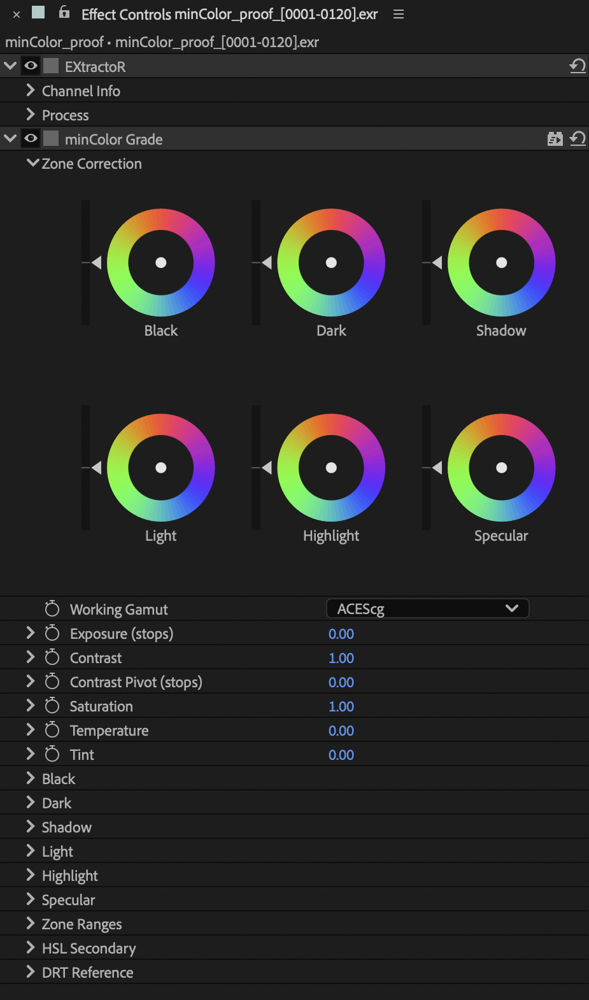

# minColor Grade

A colour corrector for linear light, whose luminance zones are measured with
the norm OpenDRT's tonescale works on. Put it between Input and Output: on a
layer, or on an adjustment layer below the Output.

- **Zone Correction** wheels: Black, Dark, Shadow over Light, Highlight,
  Specular. The puck's angle is the tint's hue, its distance from the centre the
  tint amount (the wheel's edge is full); the bar on the left is the zone's
  exposure (±4 stops). Click anywhere on a wheel or bar to put the puck or thumb
  there, drag to move it with the mouse; Shift drags finer, double-click resets.
  A tint changes colour only: the zone keeps its brightness. The wheels follow
  the width of the Effect Controls panel.
- **Working Gamut**: what the comp is in.
- **Exposure**, **Contrast** with a **Contrast Pivot** in stops over mid grey,
  **Saturation**, **Temperature**, **Tint**. Temperature and Tint are a
  white-balance shift: Temperature moves along the warm–cool (Kelvin) line, +1
  about 6500 K to 3900 K, Tint across it toward magenta (+) or green (−), and
  grey keeps its brightness.
- **Black … Specular**: each zone's Exposure, Saturation, Tint Hue and Tint
  Amount (the numeric side of the wheels).
- **Zone Ranges**: the five boundaries in stops over mid grey (defaults -3, -1.5,
  0, +1.5, +3) and a **Falloff** (default 1 stop), how far each zone blends into
  its neighbours. The zones always share a pixel out in full: the same push on
  all six is the same as that push globally, and a zone owns its own band
  (about three quarters at its centre, half at a boundary). Widen the Falloff
  for softer hand-overs.
- **HSL Secondary**: a hue / purity / level qualifier with Softness and Show Mask,
  its own wheel and correctors, and three eyedroppers: **Set Colour**, **Add to
  Range**, **Remove from Range**.
- **DRT Reference > Display Encoding**: how a pick is decoded. After Effects hands
  an eyedropper the comp's final value, before the viewer's display: in an OCIO
  project that is the working space itself, so leave the default *None - Linear /
  Working Gamut*. With a minColor Output above the Grade (Unmanaged or
  Adobe-engine projects), set it to the Output's Display Encoding.

Order of operations: the zone weights and the secondary's key are measured on the
incoming pixel; then temperature and tint, exposure, contrast, zones, saturation,
secondary. Exposure never moves a pixel into another zone, and contrast keeps hues.
