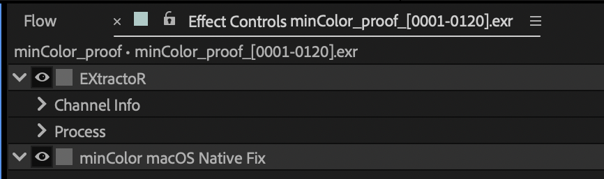

# minColor macOS Native Fix

No settings. Corrects After Effects' viewer on a Mac whose monitor is left in its
native mode, for projects that do not use OCIO (the Adobe engine). Until 0.1.7 it
was named *minColor macOS Fix*; projects that use it open as before.

On a Mac, After Effects hands the system a Display P3 picture. With the monitor
in its native mode and the vendor's profile, After Effects and macOS disagree
about the conversion, and the sRGB codes minColor Output writes look
oversaturated. The fix re-encodes them for that case: decode 2.2, Rec.709 to
P3-D65, encode 2.2.

A monitor in a mode (sRGB, Display P3) with the matching profile does not need
it, and the picture looks dull with it on. See
[color setups](../color-setups.md#the-mac-viewer-and-when-it-needs-a-fix).

Put it on a **guide layer** (Layer > Guide Layer) at the very top of the comp,
above minColor Output. Guide layers show in the viewer but are skipped by the
Render Queue and Media Encoder; on an ordinary layer the fix would be baked into
the render.

In a project made with Set OCIO you don't need the effect: pick the
**macOS native monitor (AE viewport fix)** display.
