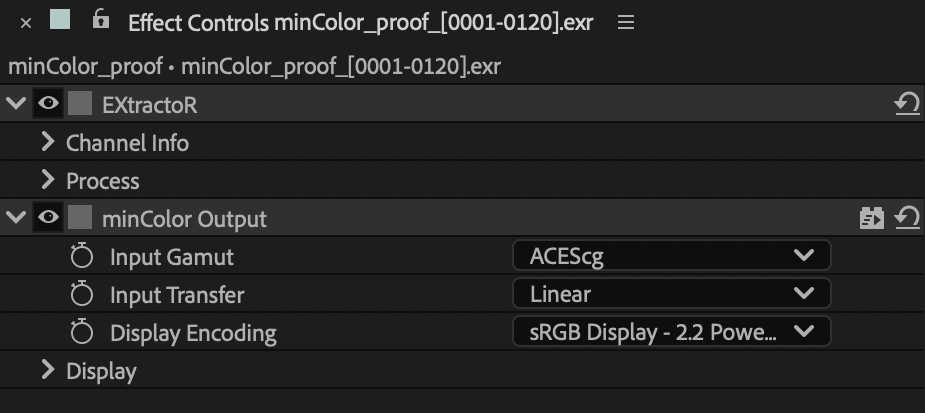

# minColor Output

Encodes the comp for a display or a delivery: a pure conversion, the gamut
matrix and the display's curve, with no tonescale and no clip. Put it on an
adjustment layer at the top of the comp; the panel's **Add Output** does this for
you.

## How it is used

- **OCIO project**: Input Gamut = the working space, Display Encoding *None -
  Linear / Working Gamut*. The Output hands back the linear light unchanged; the
  viewer's display and the Output Module encode it.
- **Unmanaged or Adobe-engine project**: the Output's Display Encoding is the
  delivery's (sRGB, Rec.709, a linear hand-off…). What it writes is what renders.
  On a Mac, add [minColor macOS Fix](macos-fix.md) on a guide layer to correct the
  viewer.

Scene 1.0 lands at display white (100 nits on PQ and HLG), so a picture that came
in through minColor Input leaves as itself, and anything brighter than display
white clips. It matches the "Un-tone-mapped" view of After Effects' own ACES
config to four decimals. For a highlight roll-off or a filmic picture, put
[minColor Knee](knee.md) or [minColor AgX](agx.md) under it.

## Controls

- **Input Gamut**, **Input Transfer**: what the comp contains (normally the
  working space, linear).
- **Display Encoding**: sets Display Gamut and EOTF together. The display presets
  (sRGB Display 2.2, Rec.1886, Display P3, Rec.2100 PQ and HLG, DCI, Dolby PQ /
  P3-D65…) plus **None - Linear** in the working gamut, ACES 2065-1, ACEScg,
  Rec.2020 or Rec.709 for linear hand-offs. Default *sRGB Display - 2.2 Power /
  Rec.709*.
- **Display** (collapsed): **Display Gamut** and **Display EOTF**, for a pairing
  no preset offers.

Until 0.1.4 the Output also offered a rendering derived from OpenDRT, with its
looks, tonescales and viewing-room setting. Those controls are hidden now; a
project saved with them keeps its settings and renders as it did.

The gamut matrices and display curves come from
[OpenDRT](https://github.com/jedypod/open-display-transform) v1.1.0 by Jed Smith;
see [CHANGES-FROM-OPENDRT.md](../../CHANGES-FROM-OPENDRT.md). minColor is not
affiliated with or endorsed by OpenDRT.
