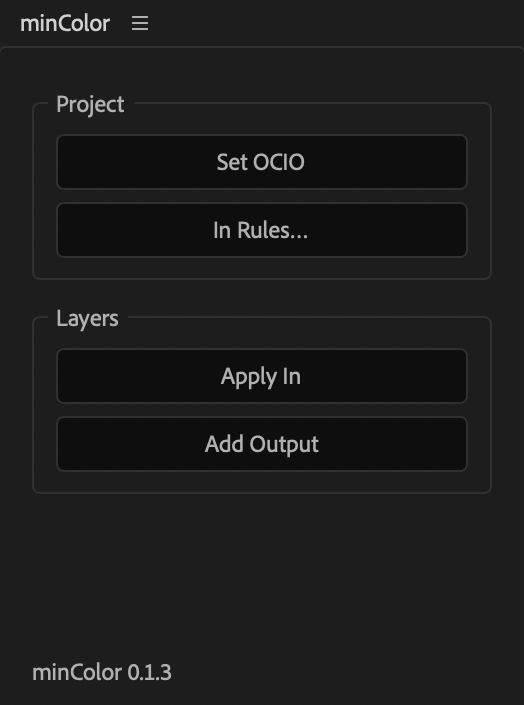
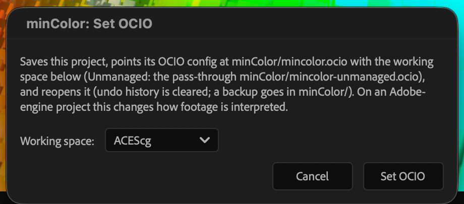
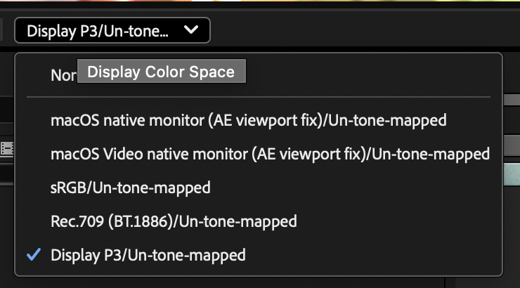
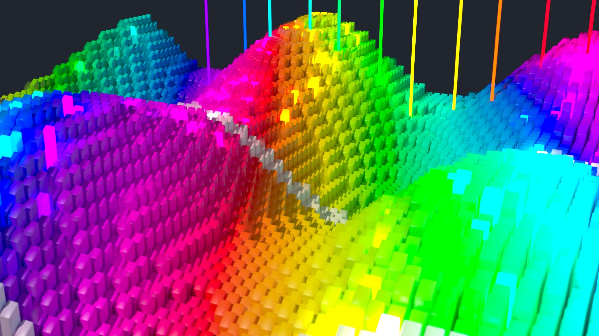
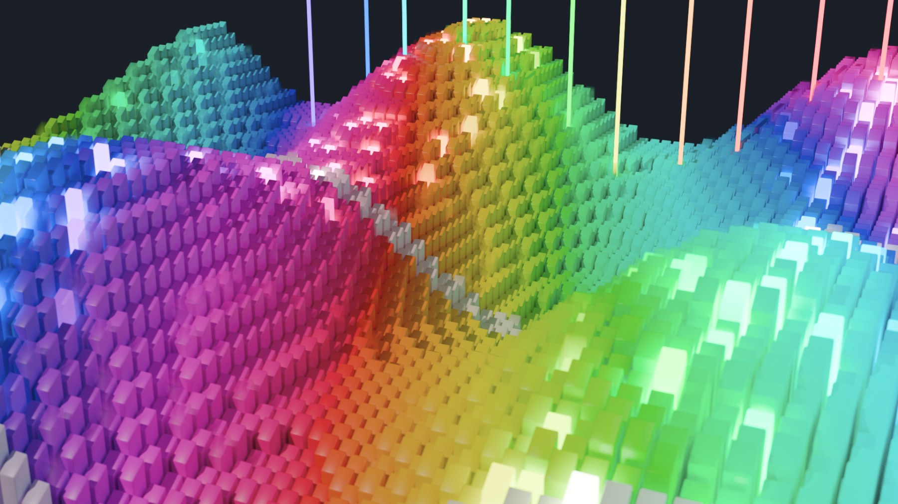

# Quick start

From an empty project to a render, in six steps. The panel does the setup.

## 1. Save the project

Create a project and save it. Set OCIO puts its files in a `minColor` folder next
to the `.aep`, so the project needs a place on disk first.

## 2. Press Set OCIO

In the minColor panel, press **Set OCIO** and choose one:

| Choice | What it means |
| --- | --- |
| A working space: **ACEScg**, Linear Rec.709, Linear P3-D65, Linear Rec.2020, ACES2065-1 | The comp holds linear light in that space. After Effects encodes it for the viewer and for the render. ACEScg is the usual one. |
| **Unmanaged** | After Effects passes pixels through. minColor Output encodes them, and what it writes is what you see and what renders. |

 

The panel sets the project to 32 bpc (8 and 16 bpc clip linear light at 1.0),
saves it, writes the config into `minColor/`, makes it the project's OCIO config,
and reopens the project. A backup of the project as it was goes in `minColor/`
too. The reopen clears the undo history.

## 3. Bring footage in with Apply In

Import your footage and put it in a comp. Select the footage layers and press
**Apply In**. Each layer gets **minColor Input**, set from its file extension:
EXR as ACEScg linear, stills and graphics as sRGB, video as Rec.709, R3D and
ARRIRAW as their camera logs. The panel lists what it will set before it does
anything, and the whole change is one undo step.

To change those assumptions for this project, press **In Rules…**. See
[the panel](panel.md#in-rules).

> **Multilayer EXRs** (Blender, Nuke): put EXtractoR (or After Effects' own
> channel extraction) on the layer first to pull out the beauty layer, then
> minColor Input after it.

## 4. Pick the viewer's display

At the bottom of the Composition panel, choose the display you are looking at:

| You are on | Choose |
| --- | --- |
| A Mac, monitor left in its native mode (the vendor's profile) | **macOS native monitor (AE viewport fix)** |
| The same, checking a Rec.709 video deliverable as a Mac plays it | **macOS Video native monitor (AE viewport fix)** |
| A Mac, monitor in sRGB or Display P3 mode with the matching profile | **sRGB** |
| Windows, an sRGB monitor | **sRGB** |
| Windows, a P3 monitor in P3 mode | **Display P3** |
| A Rec.709 reference monitor | **Rec.709 (BT.1886)** |

Which Mac row applies is explained in [Color setups](color-setups.md#the-mac-viewer-and-when-it-needs-a-fix).
In an Unmanaged project the menu has two entries: the native-monitor fix, and
**Windows (passthrough)** for every other case.

The choice is saved with the project. A script cannot set it, so a freshly set-up
project may show *None*: the picture is then dark and flat until you pick a
display.

## 5. Shape the picture (optional)

So far the picture is a plain conversion: anything brighter than display white
clips. To roll highlights off or get a filmic picture, add one of these on an
adjustment layer at the top of the comp:

- [minColor Knee](effects/knee.md): touches only the highlights.
- [minColor AgX](effects/agx.md): Blender's AgX look, adjustable.

*The same frame as a plain conversion and through AgX.*

## 6. Add Output and render

Press **Add Output**. It puts **minColor Output** on an adjustment layer at the top
of the comp, set up for the choice you made in step 2. Then add the comp to the
Render Queue. Where you choose the delivery depends on that choice:

| Set OCIO choice | Choose the delivery in | Leave alone |
| --- | --- | --- |
| A working space | **Output Module Settings > Color > Output Color Space**: sRGB, Rec.709 BT.1886 or Display P3, or a linear space for an EXR hand-off | minColor Output's Display Encoding, which Add Output sets to *None - Linear / Working Gamut* |
| Unmanaged | minColor Output's **Display Encoding**: sRGB, Rec.709, a linear hand-off and so on | The Output Module's colour space |

The two macOS displays are for the viewer only. They never appear as an Output
Color Space and are never in a render.
